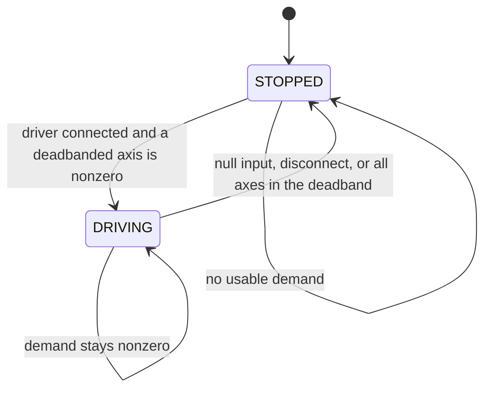

# Drivetrain FSM

Owner: `frc.robot.systems.DrivetrainFSMSystem`, one instance created by `Robot`.
Hardware: `frc.robot.subsystems.CommandSwerveDrivetrain`, built from the Phoenix Tuner X
`TunerConstants.createDrivetrain()` output.

The drivetrain is **not** a shared mechanism. `Robot` ticks it directly in teleop, autonomous,
disabled, and test, and `Robot.registerMechanism` rejects it so it cannot be double-ticked.

## States

| State | Meaning | Output |
| --- | --- | --- |
| `STOPPED` | No usable driver input, or every axis is inside the deadband | `driveFieldCentric(0, 0, 0)` |
| `DRIVING` | A nonzero chassis demand is being commanded | Scaled field-centric velocity |

`nextState(input)` answers only "is a driver controller usable": it returns `STOPPED` for null
input or a disconnected controller. `update()` then narrows a connected-but-centered stick to
`STOPPED`, so a robot sitting still with a live controller reports `STOPPED`, not `DRIVING`.

## Tick order

1. `drivetrain.updateOperatorPerspective()` — only changes alliance forward while disabled.
2. `nextState(input)`; `STOPPED` commands zero and returns.
3. `inputMapper.apply(input)`; a null demand commands zero and returns.
4. `applyDeadbandAndClamp` per axis (nonfinite becomes zero, then clamped to `[-1, 1]`, then
   deadbanded and rescaled).
5. All three axes zero commands zero and returns.
6. Scale by `Config` limits, call `driveFieldCentric`, set `DRIVING`.

`reset()` sets `STOPPED` and commands zero, so it is safe to call repeatedly.

## Configuration

`Config(maxLinearSpeedMetersPerSecond, maxAngularSpeedRadiansPerSecond, deadband)` validates in its
compact constructor: both speeds finite and positive, deadband in `[0, 1)`.

`configFromGeometry(...)` derives the angular limit as `linear / maximumModuleRadiusMeters`, so
lowering `MAX_LINEAR_SPEED_SCALE` lowers rotation proportionally.

| Value | Source | Default |
| --- | --- | --- |
| Measured free speed | `TunerConstants.kSpeedAt12Volts` | generated |
| Speed scale | `Constants.RobotIntegration.MAX_LINEAR_SPEED_SCALE` | `1.0` |
| Angular limit | derived from speed and module radius | derived |
| Deadband | `Constants.RobotIntegration.DRIVER_DEADBAND` | `0.08` |

## Inputs

`TeleopInput` normalizes the sticks; the FSM never reads a controller itself.

| Logical input | Physical control | Sign |
| --- | --- | --- |
| `DRIVETRAIN_DRIVE_X` | Left stick Y, negated | positive forward |
| `DRIVETRAIN_DRIVE_Y` | Left stick X, negated | positive left |
| `DRIVETRAIN_ROTATE` | Right stick X, negated | positive counterclockwise |

`DRIVETRAIN_RESEED` is handled in `Robot.teleopPeriodic`, because it reseeds the estimator rather
than commanding a drive output.

## Telemetry

- `Drivetrain/FSMState` — the state reported by this FSM.
- `Drivetrain/Chassis/*` — pose, measured and commanded speeds, odometry health, battery voltage.
- `Drivetrain/Modules/*` — per-module measured/target speed and angle at 20 Hz.
- `Drivetrain/Gyro/*` — rotation, rates, faults at 20 Hz.

Detailed hardware logging is throttled by `DETAILED_LOG_PERIOD_SECONDS`; chassis state logs on
every Phoenix odometry update.

## Safety behaviour

- Controller disconnected or `null` input (autonomous, disabled, test) commands zero every tick.
- `reset()` commands zero immediately and does not wait for an update.
- There is no robot-centric toggle, precision mode, slew limiter, or X-lock. Add one as a state
  plus a `nextState` transition, not as a branch inside the output path.

## Pit checks

1. Wheels off the floor: confirm the robot commands zero when the driver controller is unplugged
   and while disabled.
2. Confirm forward, strafe, and rotation signs with the robot on blocks before carpet.
3. Press Start with the robot pointed at the intended driver-forward direction; confirm the
   reported pose heading resets and `DRIVING` appears in `Drivetrain/FSMState`.
4. At low `MAX_LINEAR_SPEED_SCALE`, verify rotation scales down with translation.
